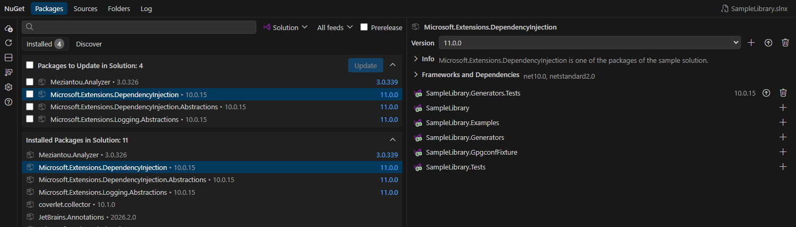
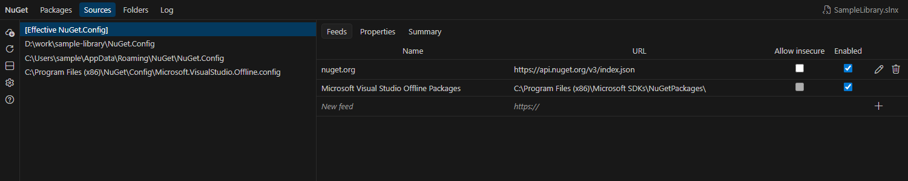
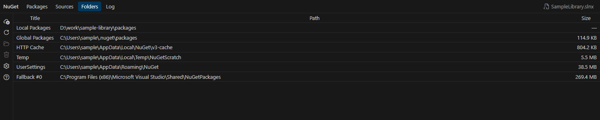
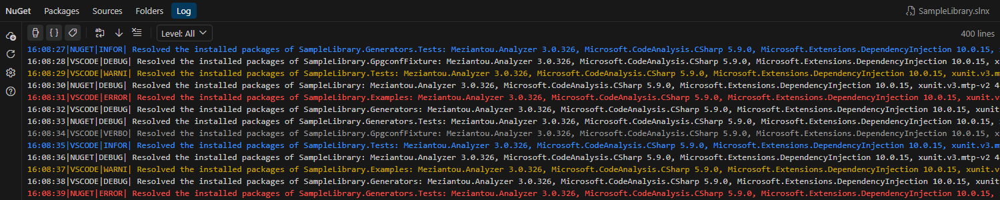

# NuGet Manager for VS Code

Manage the NuGet packages of a .NET solution without leaving the editor: see what is installed and what has updates, search the feeds, install, update and remove packages per project, edit package sources and clear the NuGet caches. The view is modelled on the NuGet window of **JetBrains Rider**, and a native .NET backend built on the NuGet client libraries does the work, so the answers are the ones `dotnet` itself would give.

> [!NOTE]
> This describes version 3, a rewrite that is not released yet. The extension published today is version 2, which works differently. Until version 3 is published, [build it from source](#build-from-source) to try it.

## What it looks like

| Packages                                                                                             | Sources                                                                                   |
| :--------------------------------------------------------------------------------------------------- | :---------------------------------------------------------------------------------------- |
|  |  |

| Folders                                                                                            | Log                                                                |
| :------------------------------------------------------------------------------------------------- | :----------------------------------------------------------------- |
|  |  |

The screenshots were taken from the development page of the view, with sample data. Every tab and control is described in [NuGet view](wiki/nuget-view.md).

## What it does

- **Packages.** The installed packages of the whole solution or of one project, the ones with a newer version, and a search of the feeds. Install, change version and remove per project, or update several packages at once. A click applies the change; nothing asks first.
- **Sources.** The feeds of every `NuGet.config` NuGet reads, and of all of them combined: add, edit, enable, disable and remove. The global and local packages folders.
- **Folders.** Where NuGet keeps packages and caches, how much each folder holds, and a way to clear the caches.
- **Log.** What NuGet and the backend are doing, as it happens.
- **Restore** with three engines: inside the backend, through MSBuild, or with `dotnet restore`.
- **Central package management**, `Directory.Build.props`, version properties and `VersionOverride` are understood: a version is changed where it is declared.
- **Private feeds.** Credentials are asked for when a feed needs them and kept in the editor's secret storage, never in a `NuGet.config`.

## Requirements

- Visual Studio Code 1.100 or newer, or an editor built from it, such as VSCodium.
- A .NET SDK. The extension looks for `dotnet` in the `nuget.dotnetPath` setting, then in `DOTNET_ROOT`, then on `PATH`. Without one it can list sources and search packages, but cannot open a solution.
- A trusted workspace: reading projects runs MSBuild, which executes code from the repository.

The backend is a native executable, so the extension is packaged for each platform:

| Package                      | Platform                        |
| :--------------------------- | :------------------------------ |
| `win32-x64`, `win32-arm64`   | Windows                         |
| `linux-x64`, `linux-arm64`   | Linux with glibc                |
| `alpine-x64`, `alpine-arm64` | Linux with musl, such as Alpine |
| `darwin-x64`, `darwin-arm64` | macOS                           |

It runs where the workspace is: with Remote SSH, WSL or a container, the backend runs beside the files and `dotnet`.

## Use it

Open a folder that has a solution or a project. The extension starts its backend, opens the solution it finds, or the one used last when there are several, and restores it. The **NuGet** item of the status bar says what the backend is doing; the **NuGet** tab of the panel is the view.

| To                       | Do                                                                             |
| :----------------------- | :----------------------------------------------------------------------------- |
| Open the view            | Select **NuGet** in the panel, or run **NuGet: Open**.                         |
| Work on another solution | Run **NuGet: Select Solution**, or click the solution's name in the view.      |
| Update several packages  | Tick them under **Packages to Update** and press **Update**.                   |
| Install a package        | Find it in **Discover**, pick a version, press `+` beside a project.           |
| Add a private feed       | **Sources**, then the `+` of the last row; the user and password are optional. |
| Free disk space          | **Folders**, select the caches, **Clear Selected Caches**.                     |

## Troubleshooting

| What you see                                          | What to check                                                                                                                                |
| :---------------------------------------------------- | :------------------------------------------------------------------------------------------------------------------------------------------- |
| The status bar says **NuGet: stopped**                | Click it to restart the backend, and read the **Log** tab or the **NuGet** output channel for why it stopped.                                |
| "The .NET SDK was not found"                          | Install an SDK, or point `nuget.dotnetPath` at `dotnet`.                                                                                     |
| The Packages tab asks to select a solution            | The workspace has several solutions and none was used before. Select one; it is remembered.                                                  |
| A package carries a warning                           | It is not restored in some project. Press **Restore**, then read the log if it fails.                                                        |
| A private feed fails and nothing asks for credentials | A prompt was cancelled, which stops the asking for that server. Run **NuGet: Clear Saved Credentials** and try again.                        |
| An update changed more projects than expected         | The version is shared, in `Directory.Packages.props` or a property. The notification that follows the update says which projects it reached. |
| Restore fails only with the embedded engine           | Set `nuget.restore.engine` to `console` or `msbuild`.                                                                                        |

## Documentation

- [NuGet view](wiki/nuget-view.md): every tab and control.
- [Extension](wiki/extension.md): activation, solution selection, settings, credentials, what happens when the backend stops.
- [Backend protocol](wiki/backend-protocol.md): the JSON-RPC methods the backend answers and how it edits project files.
- [Changelog](CHANGELOG.md).

## Build from source

With Node.js, pnpm and the .NET 10 SDK:

```powershell
pnpm install
pnpm package win32-x64
```

The second command publishes the backend with NativeAOT and writes `release-artifacts/nuget-code-win32-x64-<version>.vsix`, which **Extensions: Install from VSIX...** installs. Use the target of your own system: NativeAOT does not compile from one operating system to another. Tests, the development page of the view and the conventions of the repository are in [CONTRIBUTING.md](CONTRIBUTING.md).

## Acknowledgments

- The view follows the NuGet window of [JetBrains Rider](https://www.jetbrains.com/rider/). This project is not affiliated with JetBrains.
- [NuGet.Client](https://github.com/NuGet/NuGet.Client) supplies the libraries the backend is built on.
- The icons of the view are [codicons](https://github.com/microsoft/vscode-codicons).

## License

NuGet Manager for VS Code is licensed under the [zlib/libpng License](LICENSE.md).
