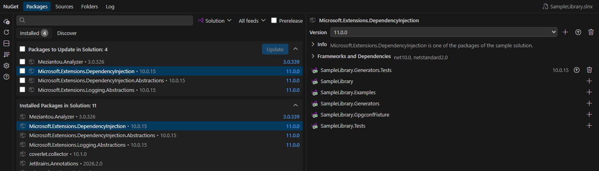
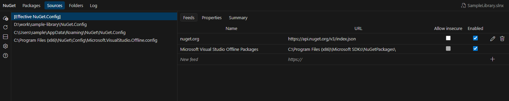
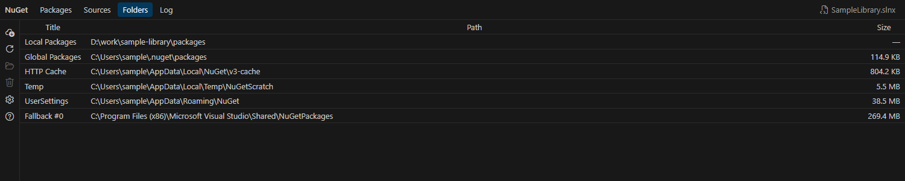
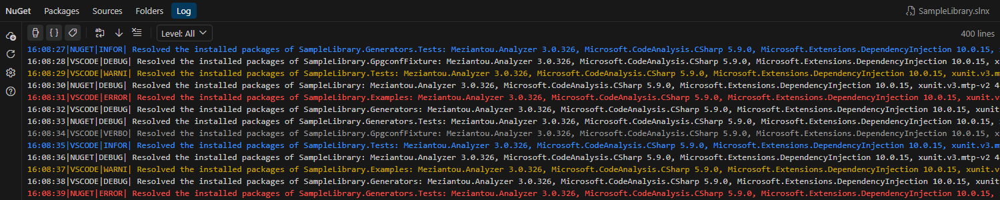

# NuGet Manager for VS Code

A NuGet package manager for .NET solutions, with the workflow of the NuGet window of **JetBrains Rider**: installed packages and their updates on one side, the details and the projects on the other, and one click to install, update or remove.

It does not shell out to `dotnet list package` and parse the answer. A native backend, built on the NuGet client libraries, reads your solution, your `NuGet.config` files and your feeds the way NuGet itself does.

## Packages

See what every project references, and act on it.

- **Installed** lists the packages of the whole solution, or of one project, with the versions in use.
- **Packages to Update** gathers the ones with a newer version. Tick some or all of them and update them together.
- **Discover** searches your feeds, all of them or one, with or without prereleases.
- The **details** show the versions, the description, the licence and the dependencies of a package, and every project of the solution: install it where it is missing, move a project to another version, or remove it.

A click applies the change and restores; nothing asks first. If the change reached further than you asked, because the version is shared by other projects, you are told afterwards.

Versions are changed **where they are declared**: in the project, in `Directory.Packages.props` with central package management, in a `VersionOverride`, in a property, in an imported `.props` file.

## Sources

Every `NuGet.config` NuGet reads for your solution, and the result of combining them.

- Add, edit, enable, disable and remove feeds, in the file you choose.
- See which file declares each feed.
- Set the global and the local packages folders.
- **Private feeds:** the user and the password are kept in the editor's secret storage, per server, and are never written to a `NuGet.config`. When a feed asks for credentials during a restore or a search, you are prompted once.

## Folders

Where NuGet keeps downloaded packages and caches, and how much disk they take.

Measure the folders, open one in the file manager, and clear the caches you select. Clearing is the only action that asks for confirmation.

## Log

What NuGet and the backend are doing, as it happens, coloured by level and filtered as you like.

## Restore

The solution is restored when it is opened and after every change. Choose the engine in `nuget.restore.engine`:

| Engine     | How it restores                                                                                         |
| :--------- | :------------------------------------------------------------------------------------------------------ |
| `embedded` | Inside the backend, without starting `dotnet`. The default; falls back to `console` when it cannot run. |
| `msbuild`  | `dotnet msbuild -t:Restore`.                                                                            |
| `console`  | `dotnet restore`.                                                                                       |

## Getting started

1. Install a **.NET SDK**, if you do not have one.
2. Open a folder with a solution (`.sln`, `.slnx`, `.slnf`) or a project.
3. Open the **NuGet** tab of the panel, beside Terminal and Output, or run **NuGet: Open**.

With several solutions in the workspace, run **NuGet: Select Solution**; the choice is remembered. The **NuGet** item of the status bar says whether the backend is starting, running or stopped.

## Requirements

- Visual Studio Code 1.100 or newer, or an editor built from it.
- A .NET SDK. `dotnet` is looked for in the `nuget.dotnetPath` setting, then in `DOTNET_ROOT`, then on `PATH`.
- A trusted workspace: reading projects runs MSBuild, which executes code from the repository.

Works on Windows, Linux (glibc and musl) and macOS, on x64 and arm64, and in Remote SSH, WSL and containers, where it runs beside your files.

## Settings

| Setting                                 | Default    | What it does                                                    |
| :-------------------------------------- | :--------- | :-------------------------------------------------------------- |
| `nuget.dotnetPath`                      | empty      | The `dotnet` executable to use.                                 |
| `nuget.restore.engine`                  | `embedded` | How packages are restored.                                      |
| `nuget.restore.onOpen`                  | `true`     | Restore the solution when it is opened.                         |
| `nuget.feedTimeoutSeconds`              | `30`       | How long a package source may take to answer.                   |
| `nuget.log.level`                       | `info`     | The least severe level written to the **NuGet** output channel. |
| `nuget.notifications.operationWarnings` | `true`     | Tell you when a change reached further than what you asked for. |

## Commands

**NuGet: Open**, **NuGet: Select Solution**, **NuGet: Restore**, **NuGet: Restart Backend**, **NuGet: Show Log** and **NuGet: Clear Saved Credentials**.

## More

- [Every tab and control of the view](https://github.com/baliestri/nuget-code/blob/main/wiki/nuget-view.md)
- [How the extension behaves](https://github.com/baliestri/nuget-code/blob/main/wiki/extension.md)
- [Report a problem](https://github.com/baliestri/nuget-code/issues)

The screenshots show sample data. This project is not affiliated with JetBrains.

## License

[zlib/libpng](https://github.com/baliestri/nuget-code/blob/main/LICENSE.md).
