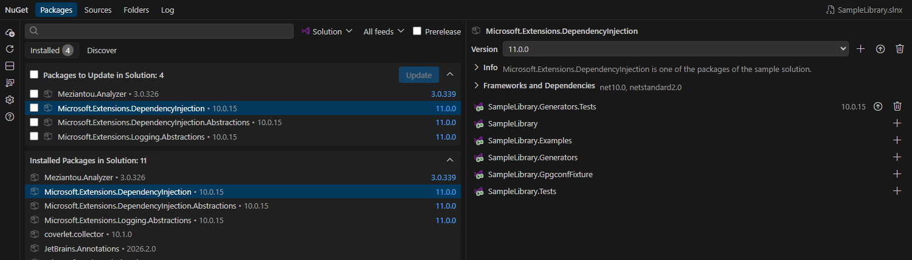
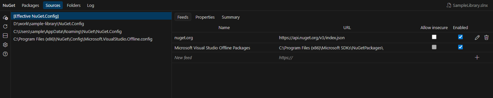
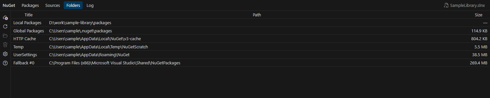
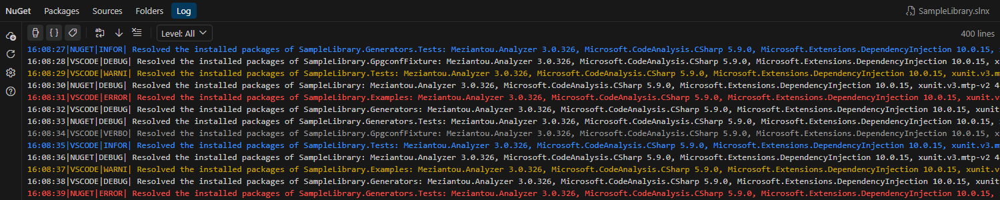

# NuGet view

The **NuGet** view is where the packages of a solution are managed: what is installed, what can be updated, the package sources, the folders NuGet keeps on disk and the log. This page is a reference of its tabs and controls as they are today. How the extension starts, selects a solution and keeps credentials is in [Extension](extension.md).

The view lives in the panel, beside Terminal and Output. To open it, select the **NuGet** tab of the panel, click the NuGet item of the [status bar](extension.md#status-bar), or run **NuGet: Open** from the Command Palette.

It has four tabs: [Packages](#packages-tab), [Sources](#sources-tab), [Folders](#folders-tab) and [Log](#log-tab). The name of the open solution is shown at the right of the tab names; clicking it selects another one. What is chosen in the view, such as the tab, the target, the feed and the log columns, is remembered for the workspace.

Every tab has a column of buttons on its left, the side bar. It always starts with **Restore** and ends with **NuGet Settings** and **Help**; the buttons in between belong to the tab.

The screenshots on this page were taken from the development page of the view, with sample data, not from the editor.

## Packages tab

The tab lists the packages of the open solution and lets them be installed, updated and removed. It needs a solution: without one it offers to select it.

The line above the lists chooses what they are about:

| Control    | Description                                                                                                                              |
| ---------- | ---------------------------------------------------------------------------------------------------------------------------------------- |
| Search     | Filters the installed packages by name and is the text searched for on the feeds. It applies a moment after typing stops.                |
| Target     | The whole solution, or one project, with how many packages it declares. A project that could not be evaluated is listed but not offered. |
| Feed       | Every enabled feed, or one of them. **Manage Feeds…** goes to the [Sources tab](#sources-tab).                                           |
| Prerelease | Whether prerelease versions count as updates and appear in the search.                                                                   |

Under it, two lists:

- **Installed** shows the packages the target references, each with the versions in use and, at the right, the newest version when there is a newer one. Those packages are also listed above, in **Packages to Update**, where they can be ticked, one by one or all at once, and updated together with **Update**. The number beside the name of the list is how many have updates. A package the SDK adds on its own is dimmed and cannot be changed. A package that is not restored carries a warning that says in which projects.
- **Discover** shows what the feeds answer to the search, up to 100 packages, each with its newest version.

Clicking the title of a group folds and unfolds it.

Selecting a package shows its details on the other side:

| Control                     | Description                                                                                                                                                |
| --------------------------- | ---------------------------------------------------------------------------------------------------------------------------------------------------------- |
| Version                     | The versions the feeds have, newest first. The buttons act on the version selected here.                                                                   |
| Install (`+`)               | Beside the version: installs it in every project of the target that does not have the package. Beside a project: installs it in that project.              |
| Change to this version      | Beside the version: moves every project that has the package to the selected version. Beside a project: moves that project. Upgrades and downgrades alike. |
| Remove                      | Beside the version: removes the package from every project. Beside a project: removes it from that project.                                                |
| Info                        | The description, the authors, the licence, the project page and the feed the details came from. Links open in the browser.                                 |
| Frameworks and Dependencies | The dependencies the package declares for each framework.                                                                                                  |

The projects of the target are listed under the details, the ones that have the package first, each with the version it has.

A click applies the change at once; nothing asks for confirmation. Only one change or restore runs at a time: while one runs, a line under the lists says which step it is at and offers **Cancel**, and the other actions are disabled. Files that were already edited when an operation is cancelled stay edited.

When the change is done, the view shows only what went wrong: a restore that failed, a file that could not be written, a cancellation. A change can also do more than was asked, such as changing a version in `Directory.Packages.props` that other projects share. That is said in a notification of the editor, which can be silenced with **Don't Show Again**, and is always written to the output channel. See `nuget.notifications.operationWarnings` in [Settings](extension.md#settings).

### Side bar controls

| Icon               | Name                                        | Description                                                                                                                       |
| ------------------ | ------------------------------------------- | --------------------------------------------------------------------------------------------------------------------------------- |
| `cloud-download`   | Restore                                     | Restores the open solution with the engine chosen in `nuget.restore.engine`. See [Restore](backend-protocol.md#restore).          |
| `refresh`          | Refresh NuGet Packages and Clear the Caches | Reads the installed packages again and asks the feeds again for updates, search results and details, without the backend's cache. |
| `split-horizontal` | Show Details Below / on the Side            | Moves the details beside the lists or under them.                                                                                 |
| `sort-precedence`  | Sort                                        | The order of the installed list: packages with updates first, or alphabetical.                                                    |
| `settings-gear`    | NuGet Settings                              | Opens the settings of the editor, filtered to the extension's.                                                                    |
| `question`         | Help                                        | Opens this page.                                                                                                                  |

## Sources tab

The tab shows the package sources and the folders a `NuGet.config` can move. It works without a solution.

The list on the left has `[Effective NuGet.Config]`, which is every file combined, and then each configuration file NuGet reads. Selecting an entry shows it in three sub-tabs.

**Feeds** is a table of the feeds:

| Column or control | Description                                                                                                             |
| ----------------- | ----------------------------------------------------------------------------------------------------------------------- |
| Name, URL         | As declared. A feed can also be a folder.                                                                               |
| Allow insecure    | Whether an `http` feed may be used.                                                                                     |
| Enabled           | Whether the feed is used. A feed of a machine-wide file can be enabled and disabled even though the file is not edited. |
| Edit              | Opens the dialog below with the values of the feed.                                                                     |
| Remove            | Removes the feed. Nothing asks for confirmation.                                                                        |
| New feed (`+`)    | The last row. Opens the dialog below, empty.                                                                            |

Where a change is written depends on the entry selected on the left. From `[Effective NuGet.Config]`, a change goes to the file that declares the feed, and a new feed goes to the `NuGet.config` of the solution, which is created when it does not exist. From a file, changes go to that file. A file that cannot be written is read-only here, with a notice.

The dialog that adds or edits a feed has **Name**, **URL**, **User**, **Password**, **Enabled**, **Allow insecure connections** and **Disable TLS certificate validation**. The user and the password are stored in the editor's secret storage, as described in [Credentials](extension.md#credentials), and never written to a `NuGet.config`; leaving them empty keeps what is stored. They can only be given for an `http` or `https` feed. An error from the backend, such as a name that is already taken, is shown in the dialog, which stays open.

**Properties** shows the **Global packages folder** and the **Local packages folder**. Each has what the selected file declares, which can be typed or chosen with the folder button, and under it what NuGet ends up using, every file considered. Emptying a field removes the declaration. They are read-only in `[Effective NuGet.Config]` and in a file that cannot be written.

**Summary** is the effective configuration as text: the files that were combined, the feeds with what is set on each, the packages folders and the fallback folders. It can be selected and copied.

### Side bar controls

| Icon               | Name                             | Description                                                    |
| ------------------ | -------------------------------- | -------------------------------------------------------------- |
| `cloud-download`   | Restore                          | As in the [Packages tab](#side-bar-controls).                  |
| `refresh`          | Reload                           | Reads the configuration files again.                           |
| `split-horizontal` | Show Details Below / on the Side | Moves the sub-tabs beside the list of files or under it.       |
| `settings-gear`    | NuGet Settings                   | Opens the settings of the editor, filtered to the extension's. |
| `question`         | Help                             | Opens this page.                                               |

## Folders tab

NuGet keeps downloaded packages and what it fetched from the feeds in folders on disk, so that a restore does not download the same thing twice. The tab lists those folders, with the configuration folders beside them, says how much each holds and can empty the caches. It works without a solution.

| Column | Description                                                                                                                           |
| ------ | ------------------------------------------------------------------------------------------------------------------------------------- |
| Title  | What the folder is: the global packages folder, the HTTP cache, the temporary folder, the fallback folders, the settings folders.     |
| Path   | Where it is.                                                                                                                          |
| Size   | `?` until it is measured, `…` while it is being measured, `—` when the folder does not exist, `failed` when it could not be measured. |

A click selects a folder; Ctrl or Cmd with a click selects several.

A measured size is remembered by the extension, for every workspace of the machine, and shown until it is measured again or thirty days have passed. Its tooltip says when it was measured.

Clearing deletes everything in the selected folders. It is offered only when every selected folder is a cache, and it is the one action of the view that asks for confirmation, in a dialog that lists the folders and their sizes. Packages are downloaded again when a restore needs them. Afterwards a notification of the editor says how much was freed and what could not be removed, usually because it is in use, and the cleared folders, with any folder that holds one of them, are measured again. A folder that could not be measured, opened or cleared says why above the table.

### Side bar controls

| Icon             | Name                     | Description                                                                |
| ---------------- | ------------------------ | -------------------------------------------------------------------------- |
| `cloud-download` | Restore                  | As in the [Packages tab](#side-bar-controls).                              |
| `refresh`        | Recalculate Folder Sizes | Measures every folder again, one after the other.                          |
| `folder-opened`  | Open Folder              | Shows the selected folder in the file manager. Needs exactly one selected. |
| `trash`          | Clear Selected Caches    | Empties the selected folders, after a confirmation.                        |
| `settings-gear`  | NuGet Settings           | Opens the settings of the editor, filtered to the extension's.             |
| `question`       | Help                     | Opens this page.                                                           |

## Log tab

The tab shows what NuGet and the backend said since the view was opened: the last 5,000 lines, coloured by level. It is shown even while the backend is starting or stopped, which is when it is most needed.

A line is `time|context|level| message`. The context is `NUGET` for the NuGet libraries and the external restore engines and `VSCODE` for the backend itself. The list stays at the end as lines arrive, until it is scrolled up; scrolling back to the end follows again.

### Toolbar controls

| Icon               | Name          | Description                                                                                                             |
| ------------------ | ------------- | ----------------------------------------------------------------------------------------------------------------------- |
| `watch`            | Show Time     | Shows or hides the time of each line.                                                                                   |
| `symbol-namespace` | Show Context  | Shows or hides where each line comes from.                                                                              |
| `tag`              | Show Level    | Shows or hides the level of each line.                                                                                  |
| `word-wrap`        | Soft-Wrap     | Wraps long lines.                                                                                                       |
| `arrow-down`       | Scroll to End | Goes to the newest line and follows new ones.                                                                           |
| `clear-all`        | Clear All     | Empties the list.                                                                                                       |
|                    | Level         | Chooses which levels are shown; any number of them. Independent of `nuget.log.level`, which governs the output channel. |

### Side bar controls

| Icon             | Name           | Description                                                    |
| ---------------- | -------------- | -------------------------------------------------------------- |
| `cloud-download` | Restore        | As in the [Packages tab](#side-bar-controls).                  |
| `refresh`        | Reload         | Empties the list; new lines keep arriving.                     |
| `settings-gear`  | NuGet Settings | Opens the settings of the editor, filtered to the extension's. |
| `question`       | Help           | Opens this page.                                               |

## Compared with Rider

The view is modelled on the NuGet window of JetBrains Rider. Some of what that window has is not here:

- There is no Package Manager Console tab.
- There is no button that upgrades every package of the solution at once; ticking every package in **Packages to Update** and pressing **Update** does the same.
- Packages have no context menu, and nothing warns about packages with known vulnerabilities.
- Restore has no "force" variant in the view.
- The available packages are shown in the order the feeds return them.
